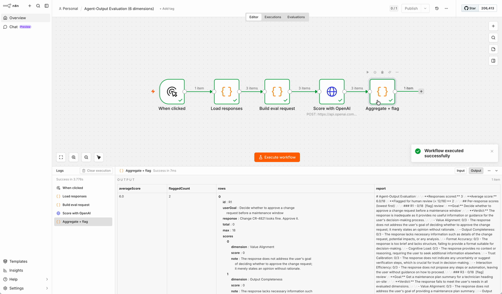

# Agent-Output Evaluation (n8n workflow)

An n8n workflow that scores a batch of AI assistant responses against a 6-dimension output-quality rubric and flags the weak ones for human review. It is the evaluation framework from my SAP Joule work, rebuilt as a running automation: a clear rubric, applied consistently, output as a prioritised list rather than a raw dump.


<!-- Replace canvas.png with a screenshot of the workflow open in n8n. -->

## The 6 dimensions

Each response is scored 0-3 on:

1. **Value Alignment** - addresses the user's actual goal, not just the literal query.
2. **Output Completeness** - contains what's needed to act, without noise.
3. **Format Accuracy** - presented in a form fit for the use (scan vs read, steps vs prose).
4. **Cognitive Load** - low interpretation effort; decisions and next steps disambiguated.
5. **Trust Calibration** - signals uncertainty, verification needs, and reversibility appropriately.
6. **Interaction Efficiency** - minimal steps to act; any automation proposed with appropriate control.

Max 18. Anything under 12 is flagged for a person to review, which is the "human checkpoint at the point of highest consequence" principle, enforced by the flow.

## What it does

```
When clicked → Load responses → Build eval request → Score with OpenAI → Aggregate + flag
```

1. **Load responses** - a sample batch of AI responses (swap for a Google Sheet / CSV / DB read).
2. **Build eval request** - runs once per response and assembles the chat-completions request (prompt + model).
3. **Score with OpenAI** - calls an OpenAI-compatible chat-completions endpoint; the model returns per-dimension scores + notes + a one-line verdict as JSON (`response_format: json_object`).
4. **Aggregate + flag** - pairs each result with its source, totals the scores, sorts weakest-first, flags sub-threshold responses, and renders a Markdown report (see [sample-report.md](sample-report.md)).

## Run it

The **Score with OpenAI** node calls `https://api.openai.com/v1/chat/completions` and authenticates with an n8n **OpenAI credential** (`openAiApi`).

1. Import `workflow.json` into n8n (Workflows → Import from File). Accept any node-version update prompts.
2. In the OpenAI credential, set **API Key** to a real `sk-...` key from platform.openai.com and leave **Base URL** at its default (`https://api.openai.com/v1`). Then open the **Score with OpenAI** node and confirm that credential is selected.
3. The model defaults to `gpt-4o` (valid on OpenAI). Change it in **Build eval request** only if you want another (e.g. `gpt-4o-mini` for lower cost).
4. Click **Execute Workflow**. Read the `report` field on the final node.

> A `401` means the credential's key is missing or invalid. `PARSE FAILED` / `0/18` across the board usually means the model id is one your key can't access.

**Using a gateway instead?** To route through LiteLLM / Azure OpenAI / a local proxy, point the node's URL at that gateway's `/chat/completions` and set the model id to one it serves. (Note: the gateway must be a real running service; an n8n Base URL like `http://localhost:5678/...` is not one.)

## Customise

- **Bring your own batch.** Replace the **Load responses** node with a Google Sheets / CSV / database read; each row becomes `{ id, userGoal, response }`.
- **Tune the bar.** Change `THRESHOLD` in **Aggregate + flag**.
- **Route the output.** Add nodes to post the summary to Slack, write scores back to the sheet, or open a ticket per flagged response.
- **A/B prompts.** Duplicate the batch with two prompt variants and compare average scores to pick the better one.
- **Switch providers.** Any OpenAI-compatible endpoint works; just repoint the credential and the model id.

## Honest limitations

This is an LLM-as-judge rubric: useful for triage and regression-spotting at volume, not a substitute for human judgement on high-stakes outputs, which is exactly why sub-threshold responses are flagged rather than auto-accepted. Scores vary run to run; treat them as signal, not gospel. Use synthetic or cleared data in anything you publish.

## Next step

Extract this into its own public repo and submit it to the [n8n community templates](https://n8n.io/workflows/) so others can run it.
